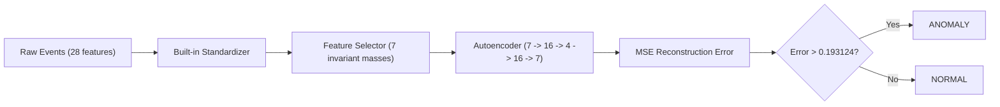
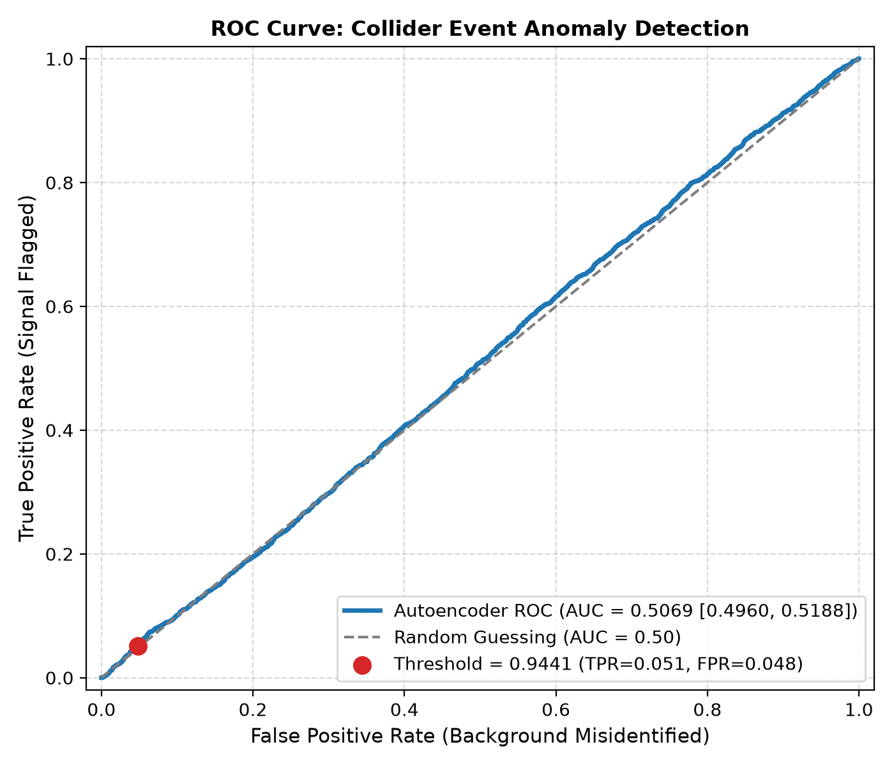
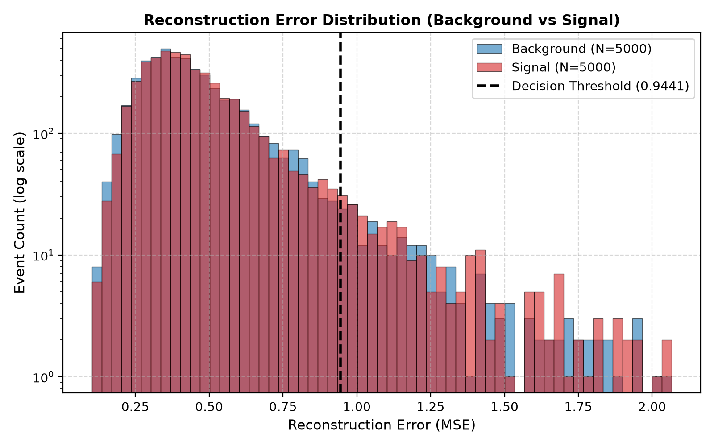
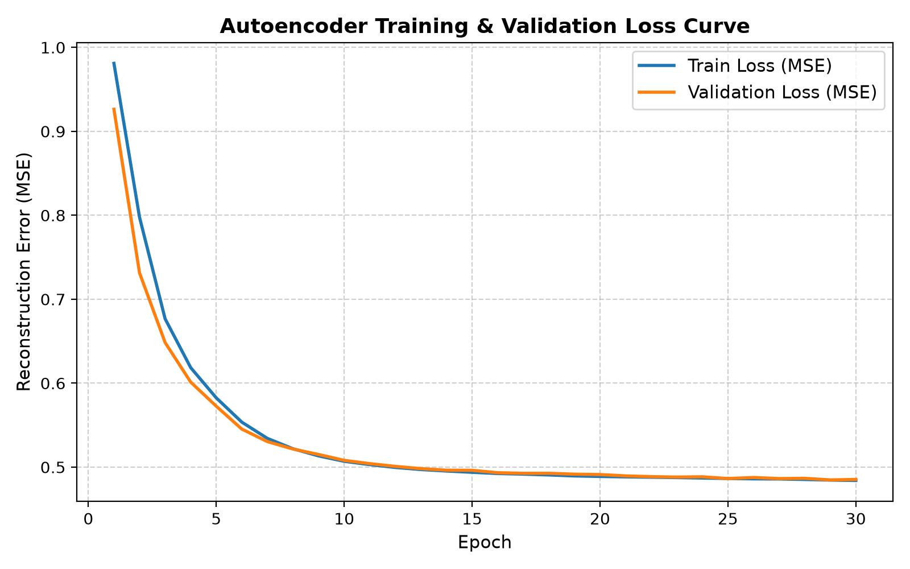

# Collider Anomaly Detection ONNX

Unsupervised collider anomaly detection using an autoencoder exported to ONNX, deployed with ONNX Runtime C++, and benchmarked for sub-millisecond single-event inference.

## Key Results

| Metric / Path | Result | Notes |
| :--- | :---: | :--- |
| **Final Test ROC AUC** | **0.5318** | 95% Bootstrap CI: [0.5209, 0.5431] (1,000 resamples) |
| **Operating Point (Threshold: 0.193124)** | **TPR: 0.0452, FPR: 0.0472** | 95th percentile validation error; no signal enrichment |
| **PyTorch Eager (CPU) Median Latency** | **184 $\mu$s** | Single-event batch size 1, 1 thread |
| **ONNX Runtime (Python) Median Latency** | **34.2 $\mu$s** | **5.38x** speedup vs PyTorch Eager |
| **ONNX Runtime (C++) Median Latency** | **20.8 $\mu$s** | **8.85x** speedup vs PyTorch Eager (1.64x vs ORT Python) |

*The detector's anomaly discrimination is weak ($0.5318$ AUC vs $0.5069$ baseline); this study demonstrates an end-to-end deployment and ultra-low latency inference feasibility rather than a physics discovery.*

## Problem Statement

At high-energy particle colliders like the LHC, rare physics processes are overwhelmed by billions of standard model background collisions. Trigger systems must filter collision events within microseconds. Unsupervised anomaly detection flags unexpected signatures via high reconstruction error without presuming a specific beyond-the-standard-model topology.

## Pipeline Architecture



## Dataset & Splits

- **Source**: UCI HIGGS via OpenML (`data_id: 23512`), citing Baldi, Sadowski, Whiteson, *Nature Communications* 5, 2014. The dataset contains 28 kinematic features: 21 low-level kinematic quantities (momentum, pseudorapidity, azimuthal angle of leptons and jets) and 7 high-level derived invariant masses.
- **Cleaning**: From 98,050 raw rows, 1 incomplete row was dropped (yielding 98,049 rows: 46,223 background, 51,826 signal), and 25 exact duplicates were removed (leaving 98,024 unique events).
- **Sampling**: Stratified sampling by label (`seed=42`) extracted a 20,000-event pool: 15,000 background (label 0) and 5,000 signal (label 1).
- **Splits**:
  - `train` = 8,000 background events (used exclusively for autoencoder optimization).
  - `val` = 2,000 background events (used for checkpoint selection and anomaly thresholding).
  - `test` = 5,000 background + 5,000 signal events (held out strictly for final evaluation).
  - `select` = 2,000 background + 2,000 signal events (drawn from pool reserve for leakage-free model selection).

## Method & Model Selection

- **Architecture**: Symmetric MLP autoencoder with standardization inside the model (buffers `mean` and `std` derived strictly from training background events) accepting raw 28-dimensional events.
- **Model Selection Protocol**: Evaluated four pre-declared variants on `data/processed/select.npz` across 3 seeds (`results/experiments/variant_selection.md`):
  - `V0` (Baseline: 28 features $\rightarrow$ 16 $\rightarrow$ 8 $\rightarrow$ 16 $\rightarrow$ 28): Mean AUC = `0.4807`
  - `V1` (22 features, drop phi $\rightarrow$ 16 $\rightarrow$ 8 $\rightarrow$ 16 $\rightarrow$ 22): Mean AUC = `0.4960`
  - `V2` (Selected: 7 invariant masses $\rightarrow$ 16 $\rightarrow$ 4 $\rightarrow$ 16 $\rightarrow$ 7): Mean AUC = `0.5103` (+0.0296 over V0)
  - `V3` (22 features $\rightarrow$ 16 $\rightarrow$ 4 $\rightarrow$ 16 $\rightarrow$ 22): Mean AUC = `0.4892`
  - Pre-registered rule selected `V2` (exceeded `+0.0100` margin over V0).
- **Decision Threshold**: `0.193124`, defined as the 95th percentile of reconstruction error on the background validation set.
- **Integrity**: The test split was evaluated only twice: baseline V0 prior to selection, and final variant V2. One crashed initial run loaded `test.npz` but aborted before computing metrics.

## Results

| Model Variant | Architecture | ROC AUC | 95% Bootstrap CI | Threshold | TPR | FPR |
| :--- | :--- | :---: | :---: | :---: | :---: | :---: |
| Baseline V0 | 28 $\rightarrow$ 16 $\rightarrow$ 8 $\rightarrow$ 16 $\rightarrow$ 28 | 0.5069 | [0.4960, 0.5188] | 0.944065 | 0.0510 | 0.0484 |
| Selected V2 | 7 $\rightarrow$ 16 $\rightarrow$ 4 $\rightarrow$ 16 $\rightarrow$ 7 | **0.5318** | [0.5209, 0.5431] | 0.193124 | **0.0452** | **0.0472** |

At the chosen operating threshold, TPR ($0.0452$) is slightly lower than FPR ($0.0472$), indicating no signal enrichment over random selection at this operating point.





## ONNX Export & Parity Verification

- **Export Configuration**: Static batch size 1, opset 17, input `features` [1, 28], output `error` [1]. Exported with `dynamo=False` in `torch.onnx.export` to bypass PyTorch 2.15 Dynamo exporter requirements.
- **Numerical Parity**: On the first 100 sample events, PyTorch vs. ONNX Runtime Python achieved a maximum absolute difference of `1.341105e-07` and mean difference of `1.190114e-08` with `0` decision disagreements. C++ vs. Python achieved exact `0.000000e+00` difference.
- **Negative Control**: Corrupting one test error by `+0.001` triggered a verification `FAILED` status (`1.000000e-03` difference). An earlier version of `verify_onnx.py` omitted strict tolerance checking on C++ outputs and was corrected in commit `e943a96`.

## Single-Event Latency Benchmark

Single-event inference latency measured on an Intel Core i5-6300U CPU @ 2.40GHz (2 physical cores, 4 logical processors), Windows 10 Pro (Build 10.0.19045), single-thread execution (`intra_op=1`, `inter_op=1`), 100 warmup runs, 10,000 timed runs across 3 interleaved repetitions:

### Benchmark Environment

- **PyTorch Version**: `2.15.0+cpu` (`torch.set_num_threads(1)`, `torch.inference_mode()`)
- **ONNX Runtime (Python)**: `1.31.1` (`CPUExecutionProvider`, sequential execution)
- **ONNX Runtime (C++)**: `1.20.1` (`MSVC 19.44.35229.0`, Build Type: `Release`)

| Inference Path | Mean ($\mu$s) | Median ($\mu$s) | p99 ($\mu$s) | Relative Speedup vs PyTorch |
| :--- | ---: | ---: | ---: | :---: |
| **PyTorch Eager (CPU)** | 449 | **184** | 8,060 | **1.00x** |
| **ONNX Runtime (Python)** | 65.7 | **34.2** | 200 | **5.38x** |
| **ONNX Runtime (C++)** | 37.5 | **20.8** | 93.5 | **8.85x** |

### Per-Repetition Measurements (Run 2)

| Path | Rep 1 Median ($\mu$s) | Rep 2 Median ($\mu$s) | Rep 3 Median ($\mu$s) | Repetition Spread (%) |
| :--- | ---: | ---: | ---: | ---: |
| PyTorch Eager (CPU) | 184 | 183 | 185 | 1.1% |
| ONNX Runtime (Python) | 34.5 | 34.2 | 34.2 | 0.9% |
| ONNX Runtime (C++) | 20.8 | 20.5 | 21.2 | 3.4% |

### Across-Run Stability & History

- In 4 repeated executions (runs 2-5 in `results/benchmark_history.md`), median latencies remained consistent: PyTorch spread was 1.41% (181.90-184.50 $\mu$s), ORT Python was 3.49% (33.80-35.00 $\mu$s), and ORT C++ was 0.96% (20.70-20.90 $\mu$s).
- **Transparency Note**: A first run (run 1) showed a 70.6% spread between repetitions for ONNX Runtime Python. Its raw data was not retained, and the cause was not investigated or determined. The benchmark was repeated and the later runs are reported here.
- **How to Read This**: ONNX Runtime Python and C++ execute the same engine (`CPUExecutionProvider`). The latency gap is hypothesized (unmeasured) to arise from Python C-API argument conversion and call overhead. PyTorch's higher latency is hypothesized (unmeasured) to stem from dynamic framework dispatch and interpreter overhead.

## Project Structure

```
collider-anomaly-detection-onnx/
├── cpp/
│   ├── CMakeLists.txt       # CMake build configuration for ONNX Runtime C++
│   └── inference.cpp        # C++ inference CLI with single-event benchmarking
├── data/
│   ├── higgs_sample.csv     # OpenML HIGGS validated dataset (git-ignored)
│   └── sample_events.csv    # 1,000-event demo subset (tracked)
├── models/
│   ├── autoencoder.pt       # Trained PyTorch model checkpoint
│   ├── detector_model.onnx  # Exported ONNX computation graph
│   ├── threshold.json       # Anomaly decision threshold metadata
│   └── threshold.txt        # Plaintext anomaly threshold float
├── python/
│   ├── benchmark.py         # 3-way interleaved latency benchmark suite
│   ├── config.py            # Global paths, constants, and hyperparameters
│   ├── download_data.py     # OpenML dataset ingestion and validation
│   ├── evaluate.py          # Test set evaluation, ROC AUC, and metric plots
│   ├── export_onnx.py       # PyTorch to ONNX export wrapper (opset 17)
│   ├── model.py             # Autoencoder architectures with built-in standardizer
│   ├── prepare_data.py      # Stratified sampling and non-overlapping split partitioning
│   ├── select_model.py      # Pre-declared architecture variant selection harness
│   ├── train.py             # Unsupervised background training loop
│   └── verify_onnx.py       # Numerical parity and negative control verification
├── results/
│   ├── benchmark.md         # Measured headline latency benchmark report
│   ├── benchmark_history.md # Multi-run latency reproducibility log
│   ├── cpp_errors.txt       # C++ single-event reconstruction errors (100 events)
│   ├── metrics.md           # ROC AUC, TPR, FPR, and error distribution summary
│   └── onnx_verification.md # Parity verification between PyTorch, ORT, and C++
└── tests/
    ├── test_benchmark.py    # Unit tests for statistical formulas and CLI options
    ├── test_data.py         # Dataset schema, split sizes, and leakage tests
    ├── test_evaluate.py     # Metric calculation, AUC, and CI bootstrap tests
    ├── test_model.py        # Model forward/backward pass and standardization tests
    └── test_onnx.py         # ONNX graph checker and parity tests
```

## How to Run (Windows PowerShell)

```powershell
# 1. Environment & Dependencies
python -m venv .venv
.\.venv\Scripts\Activate.ps1
pip install -r requirements.txt

# 2. Pipeline Execution
python python\download_data.py
python python\prepare_data.py
python python\train.py
python python\evaluate.py
python python\export_onnx.py
python python\verify_onnx.py --cpp-errors results\cpp_errors.txt

# 3. C++ Build & Execution (CMake & MSVC)
cmake -S cpp -B build -A x64 -DONNXRUNTIME_DIR="C:\onnxruntime"
cmake --build build --config Release
.\build\Release\collider_inference.exe --model models\detector_model.onnx --csv data\sample_events.csv --threshold-file models\threshold.txt --n 5 --out $env:TEMP\demo_out.txt

# 4. Latency Benchmark & Tests
python python\benchmark.py
python -m pytest -v
```

## Limitations & Future Work

- **Simulated Physics**: HIGGS is a simulated benchmark dataset with high background-signal overlap; unsupervised autoencoders achieve modest separation.
- **Single Machine & Seed**: Latency and model weights are evaluated on a single dual-core CPU with seed 42. MinGW toolchains remain untested.
- **Hypotheses Untested**: Causal explanations for latency gaps (dispatch, cache, binding) remain hypotheses. Supervised baselines would provide a useful performance reference.

## Citation & License

- Dataset: P. Baldi, P. Sadowski, and D. Whiteson. "Searching for exotic particles in high-energy physics with deep learning." *Nature Communications* 5, 4308 (2014).
- License: MIT License.
